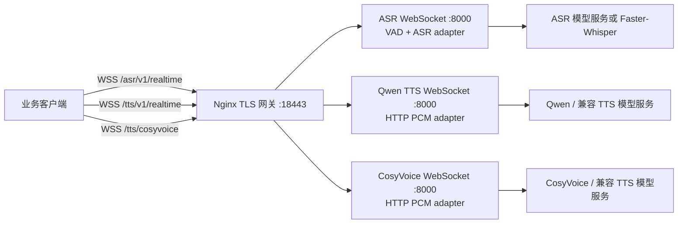

# Speech Model WebSocket Services

这个目录实现协议 v2 的三个语音 WebSocket 服务，以及一个独立的 LLM Chat Completions WebSocket bridge。ASR 服务内部运行 VAD；Qwen TTS 和 CosyVoice 路径分别接自己的推理后端。TLS 网关统一暴露 `18443`，模型适配容器只加入 Docker 内网，不发布宿主机端口。

## 组件和数据流



`ASR` 可在自身进程运行 Faster-Whisper，也可把经内部 VAD 截取的 PCM WAV 发给 OpenAI 兼容的转写 API。两个 TTS 适配器分别请求 `/v1/audio/speech`，读取 raw PCM16 响应流并原样转成 WebSocket 二进制帧。若模型服务不是 OpenAI 兼容协议，只需要在 `backends.py` 中实现 `ASRBackend` 或 `TTSBackend` 并接入对应 factory；WebSocket 协议层不依赖具体模型。

LLM bridge 将 Chat Completions JSON 请求转发到本机 OpenAI 兼容的 `/v1/chat/completions`，并把上游 SSE 的每个 `data:` 内容作为 WebSocket 文本帧发回。请求中的 `tools` 和 `tool_choice` 会原样传递，增量 `tool_calls` 不做缓冲；bridge 固定服务端模型名并强制 `stream=true`。这是 Chat Completions over WebSocket，不是 OpenAI Realtime 语音协议。

当前内置能量 VAD 会检测 20 ms PCM16 帧，保留语音区域及前后 padding，提交时只把筛出的音频交给 ASR。它是部署结构里的默认实现，阈值可通过环境变量调节。生产环境有复杂噪声或远场拾音时，可替换成 Silero/WebRTC 等 VAD backend；VAD 仍位于 ASR 容器内部，不需要额外公网服务。

## 部署

要求 Docker Compose v2、可访问的模型推理服务，以及网关证书。推理模型可以和本目录分开部署在 GPU 主机或独立容器；这里的三个服务负责模型适配、WebSocket 协议、鉴权和流量隔离。

### Linux 主机本机部署 ASR

ASR 也可以作为 systemd 服务直接运行在 Linux 主机上，不需要启动本仓库的 Docker Compose。`deploy/asr-ws.service` 绑定配置指定的内网地址；环境变量模板 `deploy/asr.env.example` 使用本地能量 VAD 和官方 Qwen3-ASR Transformers backend。其他 ASR backend 仍可按需配置。模型目录须预先准备 `config.json`、tokenizer、processor 元数据和 safetensors 权重文件。

在 GPU 主机 `/app/sts_ws_server` 中，使用独立的 Qwen3-ASR 环境安装 CUDA 版 PyTorch、Transformers 和服务依赖，然后将本地代码同步到该目录。设置 `/etc/sts-ws-server/asr.env`（权限 `0600`），并放入高熵 `WSS_API_KEY`。安装 unit 后执行 `sudo systemctl daemon-reload && sudo systemctl enable --now asr-ws.service`。`GET http://<内网绑定地址>:8011/healthz` 检查进程配置；ASR 模型在进程导入时加载，首次启动需等模型加载完成。

当前部署使用官方 [`Qwen/Qwen3-ASR-1.7B`](https://huggingface.co/Qwen/Qwen3-ASR-1.7B)，模型目录为 `/app/sts_ws_server/models/asr/qwen3-asr-1.7b`。由于共享 TTS 环境使用 Transformers 5，而 `qwen-asr==0.0.6` 固定 Transformers 4.57.6，Qwen3-ASR 使用独立的 `/app/sts_ws_server/venv-qwen3-asr` 环境：

```bash
cd /app/sts_ws_server
python3 -m venv venv-qwen3-asr
# 按主机 CUDA 版本安装匹配的 PyTorch wheel。
venv-qwen3-asr/bin/python -m pip install --index-url https://download.pytorch.org/whl/cu124 'torch>=2.2'
venv-qwen3-asr/bin/python -m pip install -e '.[qwen3-asr]'
hf download Qwen/Qwen3-ASR-1.7B \
  --local-dir /app/sts_ws_server/models/asr/qwen3-asr-1.7b
```

`asr-ws.service` 已固定使用该独立 Python 环境、`ASR_BACKEND=qwen3`、`ASR_DEVICE=cuda:4` 和 `ASR_COMPUTE_TYPE=bfloat16`。当前服务监听 `127.0.0.1:8011`，由已有 TLS 网关转发 `/asr/v1/realtime`；模型端口不直接暴露到公网。

反向代理如需将现有 `/asr/` 路径切到本服务，应保留完整请求 URI，并在代理请求中设置内部 bearer key，其中该 key 必须与 ASR 环境文件中的 `WSS_API_KEY` 一致。继续保留网关已有的外部鉴权和限流规则。确认 ASR 服务健康、WebSocket 鉴权与转写正常后，再 reload 网关。

```bash
cd /Users/rgwei/pj/pj_audio/sts_ws_server
cp .env.example .env
```

编辑 `.env`：设置高熵 `WSS_API_KEY`，配置 ASR/Qwen/CosyVoice 后端地址、模型名和音色。默认 TTS 地址是宿主机的 `8091`、`8092`，ASR 的兼容 API 示例地址为 `8090`。Linux Docker Compose 已配置 `host.docker.internal` 到宿主机网关的解析。

开发联调可把三个 backend 都设成 `mock`，它会返回可播放的测试音调，不代表真实语音合成：

```dotenv
ASR_BACKEND=mock
QWEN_TTS_BACKEND=mock
COSYVOICE_TTS_BACKEND=mock
```

生产或真实模型联调时，恢复 `.env.example` 里的 Faster-Whisper/OpenAI 兼容设置。Qwen 示例可使用 `speech-to-speech` 项目文档中的 vLLM-Omni Qwen3-TTS 服务（`POST /v1/audio/speech`，24 kHz PCM）；先在 GPU 模型主机上安装与 vLLM 匹配的 vLLM-Omni，再启动：

```bash
vllm serve Qwen/Qwen3-TTS-12Hz-1.7B-CustomVoice \
  --deploy-config vllm_omni/deploy/qwen3_tts.yaml \
  --omni --port 8091 --trust-remote-code --enforce-eager
```

对应将 `QWEN_TTS_BASE_URL` 设为 `http://<模型主机>:8091/v1`，`QWEN_TTS_MODEL` 设为该模型 ID。CosyVoice 推理后端需暴露相同的 OpenAI 兼容 PCM streaming 请求；若使用官方服务的原生协议，在此服务与官方模型进程之间加一个薄适配器即可。ASR 也可用 `ASR_BACKEND=openai` 将识别委派给独立 GPU 推理服务，ASR 服务仍负责 VAD 和客户端协议。

将证书放到 `TLS_DIR` 指向目录中的 `tls.crt` 和 `tls.key`。本地临时证书示例：

```bash
mkdir -p tls
openssl req -x509 -newkey rsa:3072 -nodes -days 30 \
  -keyout tls/tls.key -out tls/tls.crt \
  -subj '/CN=localhost' \
  -addext 'subjectAltName=DNS:localhost,IP:127.0.0.1'
```

生产环境请使用与域名匹配的正式证书。启动并检查：

```bash
docker compose up --build -d
docker compose ps
curl --cacert tls/tls.crt https://localhost:18443/healthz
```

只有网关映射宿主机端口 `18443`。ASR/TTS 容器和模型服务端口不通过此 Compose 文件向公网发布。云安全组只允许业务方出口地址访问 TCP 18443。

`GET /healthz` 用于进程存活和适配器配置检查，不会主动探测外部 TTS/ASR 模型 API。真实模型上游不可达时，WebSocket 请求会收到协议 `error` 事件；请同时监控上游推理服务的健康检查和请求失败率。

### Sarashina 固定参考音色

`/tts/sarashina` 支持通过 `voice` 字段选择零样本参考音色，仅影响 Sarashina endpoint。默认角色与三个角色的参考样音在 `deploy/sarashina-voices.example.json` 中配置；JSON 中相对音频路径相对于该配置文件解析。部署时将 `voice_example/` 和 `deploy/sarashina-voices.example.json` 一并同步到服务器，并在 Sarashina 环境文件中设置 `SARASHINA_VOICE_PROFILES=/app/sts_ws_server/deploy/sarashina-voices.example.json`。模型启动时为每个 profile 提取并缓存 speaker embedding、semantic tokens 和 mel 特征，后续连接按 `voice` 复用。`SARASHINA_REFERENCE_AUDIO` / `SARASHINA_REFERENCE_TEXT` 单参考配置仍兼容；启用 profile JSON 后以前者为准。随机采样仍可能改变语调和语速。

| voice | 角色 | 参考音频 |
| --- | --- | --- |
| `sakura` | 明亮灵动的导航员 | `voice_example/0_003.wav` |
| `tsubaki` | 温柔稳重的解说员 | `voice_example/121_002.wav` |
| `yuki` | 沉静知性的顾问 | `voice_example/16_003.wav` |

请求可显式选择角色；省略 `voice` 时使用配置中的 `default_voice`（当前为 `sakura`）：

```json
{"type":"response.create","text":"こんにちは。","language":"ja","voice":"tsubaki"}
```

三个 profile 的 transcript 必须与对应参考音频一致。增加角色时，在 JSON 的 `voices` 对象添加唯一 ID、显示名、音频路径和 transcript 即可；缺少参考文件时健康检查会返回 `not_ready`，未知 `voice` 会返回 `error`。

### LLM Chat WSS

模型服务只绑定本机地址；LLM WSS bridge 单独运行并负责 bearer 鉴权和 TLS。设置 `WSS_API_KEY`、`LLM_BASE_URL` 和 `LLM_MODEL` 后，可使用：

```bash
uvicorn sts_ws_server.llm_wss:app \
  --host 0.0.0.0 --port 18444 \
  --ssl-certfile tls/llm-wss.crt --ssl-keyfile tls/llm-wss.key
```

服务进程监听 `18444`。在 Thor 部署中，公网通过现有 TLS 网关 `18443` 暴露 `wss://<host>:18443/ws/v1/chat/completions`；网关校验客户端 bearer token 后，使用单独的内部 `WSS_API_KEY` 访问 bridge。客户端使用当前业务方已获发的网关 bearer token；不要把内部 `WSS_API_KEY` 配置到客户端。直连 `18444` 仅用于受控内部诊断，不应作为公网入口。客户端发送一条标准 Chat Completions JSON 请求。bridge 会在转发时加入高优先级语言规则：无论输入是什么语言，回答或翻译结果都必须使用自然、礼貌的日语；明确要求翻译时只返回日语译文，并拒绝按输入语言输出。它同时保留客户端已有的首条 system/developer 消息；服务端语言要求优先于客户端的其他语言要求。systemd unit 显式设置 `PYTHONPATH=/app/sts_ws_server/src`，确保线上 bridge 加载当前项目源码中的语言策略。直连本机模型端口不受此约束。每个上游 SSE `data:` 内容作为一条 WebSocket 文本消息返回，最后一帧为文本 `[DONE]`。出错时收到 `{"error":{"message":"..."}}`；请求和模型响应正文不会写入服务日志。

Thor 上的 Ornith 部署使用 `/app/sts_ws_server/models/ornith/Ornith-1.5-35B-Q8_0.gguf`，`llama-server` 仅绑定 `127.0.0.1:18080`，使用 GPU 0 和 2、32K context、单并发；`llama-server.service` 和 `llm-wss.service` 是 systemd 用户服务，已启用 linger 以支持登出后和重启后的启动。公网 TLS 由已有 18443 网关终止；其证书为自签名证书，客户端需信任现有网关证书。

## 本地运行和测试

### 远程 GPU 服务启动

远程部署目录为 `/app/sts_ws_server`。在远程用户 `roger` 下执行：

```bash
cd /app/sts_ws_server
chmod +x start.sh
./start.sh --dry-run
./start.sh
```

Qwen3-ASR 的 `asr-ws.service` 使用独立的 `/app/sts_ws_server/venv-qwen3-asr`；其余 Python 服务使用 `/app/sts_ws_server/venv`（Python 3.13）。共享环境包含 Qwen/Kokoro TTS、LLM bridge 以及 Qwen3-TTS 的 vLLM-Omni 运行时；旧的 `/app/sts_ws_server/venv-py314-old` 仅作为回滚备份保留。`llama-server` 是独立的原生可执行文件，不属于 Python venv。

脚本会从已有环境文件复用 `WSS_API_KEY`；首次部署没有 key 时自动生成 64 位随机 key。也可以显式传入一个高熵 key：

```bash
./start.sh --key '替换为至少 32 个字符的随机密钥'
```

也可以通过环境变量配置：

```bash
WSS_API_KEY="$(openssl rand -hex 32)" ./start.sh
```

需要轮换 ASR/Qwen adapter key 时才使用：

```bash
./start.sh --rotate-key
```

adapter key 会写入并保持权限 `0600` 的以下文件：

```text
/etc/sts-ws-server/asr.env
/app/sts_ws_server/wss.env
```

`ornith.env` 中的 LLM bridge 内部 key 必须与公网 Nginx 的 `ORNITH_WSS_API_KEY` 一致，脚本不会覆盖它。公网客户端的 `MIMO_API_KEY` 则必须匹配 Nginx 中 `shanghai-backend` 对应的客户端 key；这是两个独立的认证值。轮换 adapter key 不会自动更改公网客户端 key 或网关配置。

启动顺序是 Qwen3-TTS 模型服务、Qwen TTS WebSocket adapter、ASR WebSocket、llama-server、LLM WebSocket bridge。已有的公网 Docker/Nginx 网关不会由脚本重建；公网入口仍是 `wss://47.87.138.166:18443`。检查状态：

```bash
./start.sh --status
```

`--status` 和 `--dry-run` 不会改写配置。实际启动需要远程账号对 ASR 的 `/etc/sts-ws-server/asr.env` 具备 `sudo` 写权限；若 SSH 会话需要分配终端，请使用交互式终端执行脚本。

公网客户端认证头是 `Authorization: Bearer <Nginx shanghai-backend 客户端 key>`。脚本只输出 adapter key 的 SHA-256 前 12 位指纹，不输出原文。

```bash
uv venv .venv
uv pip install --python .venv/bin/python -r requirements.txt
WSS_API_KEY=dev-key SERVICE_NAME=all .venv/bin/uvicorn sts_ws_server.app:app --host 127.0.0.1 --port 8000
```

`requirements.txt` 是包含服务、ASR/VAD/Kotoba、Kokoro、Qwen3-TTS vLLM-Omni、测试和公网 WSS demo 的完整安装列表。vLLM 条目带 Linux 平台标记；macOS 开发机不会安装它。GPU 主机应先按照 CUDA 版本安装匹配的 PyTorch wheel，再执行该文件；不要为了安装 Python 依赖替换已经可用的 CUDA PyTorch：

```bash
python -m pip install --index-url https://download.pytorch.org/whl/cu124 torch
python -m pip install -r requirements.txt
```

如果只运行 HTTP 兼容 adapter，不加载本地 ASR/Kotoba 模型，可以只安装 `pyproject.toml` 的基础依赖：

```bash
python -m pip install -e .
```

Faster-Whisper 本地 ASR 需安装可选依赖并配置模型：

```bash
uv pip install --python .venv/bin/python -r requirements.txt
WSS_API_KEY=dev-key SERVICE_NAME=asr ASR_BACKEND=faster-whisper \
  ASR_MODEL=small ASR_DEVICE=cpu ASR_COMPUTE_TYPE=int8 \
  .venv/bin/uvicorn sts_ws_server.app:app --host 127.0.0.1 --port 8001
```

协议自动化测试不加载模型：

```bash
.venv/bin/python -m pytest -q
```

可将 `demo1` 客户端的 `MIMO_WSS_BASE_URL` 设为 `wss://localhost:18443`、`MIMO_API_KEY` 设为相同 bearer key，并提供 CA 证书，验证与现有客户端兼容。

## 协议和限流

| WebSocket 路径 | 服务 | 推理输入 | 输出 |
| --- | --- | --- | --- |
| `/asr/v1/realtime` | ASR + 内部 VAD | 16 kHz、mono、PCM S16LE；`input_audio.commit` 触发识别 | `transcription.completed` |
| `/tts/v1/realtime` | Qwen TTS adapter | `response.create` JSON | `response.audio.started`、PCM 二进制帧、`response.completed` |
| `/tts/kokoro` | Kokoro Japanese TTS adapter | `response.create` JSON | `response.audio.started`、PCM 二进制帧、`response.completed` |
| `/tts/cosyvoice` | CosyVoice adapter | `start`、多条 `text`、`end` | `audio_format`、PCM 二进制帧、`done` |
| `/ws/v1/chat/completions` | LLM Chat Completions bridge | 标准 Chat Completions JSON，含可选 `tools` | 每条 SSE `data:` 作为一条文本帧，最后为 `[DONE]` |

三个端点都校验 `Authorization: Bearer ...`。单条 ASR 会话默认最多缓存 120 秒音频；文本默认最多 10,000 字符；每个进程默认最多 2 个同时推理的请求。服务按 GPU/模型显存情况调整 `MAX_CONCURRENT_REQUESTS`，同一张 GPU 上建议 ASR/TTS 模型进程各自独立限流，不要通过增加 Uvicorn worker 复制模型。

TTS 返回音频为 24 kHz mono PCM S16LE。`TTS_AUDIO_CHUNK_BYTES=4096` 是内部 HTTP 读取块大小，WebSocket 会在模型数据可用时逐块转发；生产模型流应直接输出 PCM，而不是先等待完整 WAV 文件。每个 HTTP backend 进程复用连接池，并在服务 shutdown 时关闭，减少 CosyVoice 按句请求时的重复建连开销。

## 关键配置

| 配置 | 含义 |
| --- | --- |
| `SERVICE_NAME` | `asr`、`qwen-tts`、`cosyvoice`、`kokoro`、`llm` 或本地联调用的 `all` |
| `WSS_API_KEY` | 三个 WS endpoint 的共享 bearer token |
| `ASR_BACKEND` | `qwen3`、`faster-whisper`、`kotoba`、`openai` 或 `mock` |
| `ASR_MODEL` / `ASR_DEVICE` / `ASR_COMPUTE_TYPE` | ASR 模型路径、运行设备和精度；Qwen3 当前使用本地路径、`cuda:4`、`bfloat16` |
| `ASR_MAX_NEW_TOKENS` | Qwen3-ASR 单次识别的最大生成 token 数 |
| `ASR_BASE_URL` / `ASR_HTTP_MODEL` | OpenAI 兼容的 `/audio/transcriptions` 上游 |
| `QWEN_TTS_BASE_URL` / `QWEN_TTS_MODEL` | Qwen 兼容的 `/audio/speech` 上游 |
| `COSYVOICE_TTS_BASE_URL` / `COSYVOICE_TTS_MODEL` | CosyVoice 兼容的 `/audio/speech` 上游 |
| `VAD_RMS_THRESHOLD` / `VAD_PADDING_MS` | ASR 内置能量 VAD 阈值和语音边界 padding |
| `MAX_AUDIO_SECONDS` / `MAX_TEXT_CHARS` | 单请求输入上限 |
| `MAX_CONCURRENT_REQUESTS` | 单进程的模型调用并发上限 |
